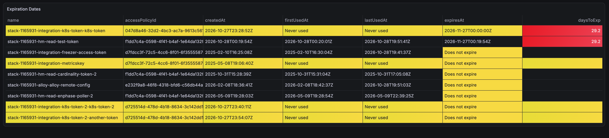

# Grafana Access Token Dashboard
This creates a Grafana dashboard that lists metadata about Grafana Cloud access policy tokens.  You can use it to quickly identify tokens that have never been used or are close to expiration.  See the screenshot below for an example of what this will look like.

## Requirements
The data for this dashboard comes from the grafana.com/api/v1/tokens endpoint.  You need to configure the [Grafana Infinity datasource](https://grafana.com/docs/plugins/yesoreyeram-infinity-datasource/latest/) to query that API.

### Configuring the Infinity datasource
To configure the Infinity datasource, do the following:
1. Log in as a Grafana Cloud Portal at https://grafana.com.
2. Click on the **Details** button next to one of your Grafana cloud stacks.
3. In the left hand column, click on **Security - Access Policies**
4. Find or create an access policy with the **accesspolicies:read** scope.
5. Generate a token from that access policy. Be sure to store the token somewhere safe, you'll only be able to view it once.
6. In your Grafana Cloud stack, navigate to **Connections - Data sources**
7. Add a new instance of the Infinity data source.  Name it **token-infinity-datasource**.
8. When the new datasource is installed, navigate to **Settings - Authentication**.
9. Set the Auth type to **Bearer Token**, paste the token you generated in step 5 above into **Auth details - Bearer token**, and add **https://grafana.com** as an allowed host.
10. Click **Save & test**

### Identifying your Grafana Cloud region
The dashboard query needs to be configured with your Grafana Cloud region.  Here's one way to find that:
1. Log in as a Grafana Cloud Portal at https://grafana.com.
2. Click on the **Details** button next to one of your Grafana cloud stacks.
3. Find the **Grafana - Go to Grafana Cloud** tile and click on the **Details** button.
4. Under instance details, find **Grafana Cloud cluster / region** and note what you see there (i.e.prod-us-east-0).
 
## Importing and configuring the dashboard
1. Download the **access-tokens.json** file from this repo and navigate to the **Dashboards** page in your Grafana Cloud stack.
2. Click **New - Import Dashboard** and drag and drop **access-tokens.json** onto that page.  The dashboard will upload.
3. The new dashboard will be called **Access Policy Expiration**, open it and click **Edit** on the **Expiration Dates** panel.
4. In the **URL** field, edit the region parameter to reflect the region your Grafana Cloud stack is running in (i.e. region=prod-us-east-0)

The dashboard should list all Grafana Cloud Access tokens.  Lines with yellow highlights show tokens that have never been used or do not expire.  If a token is less than 30 days from expiration, you'll see a red highlight in the daysToExp column.
